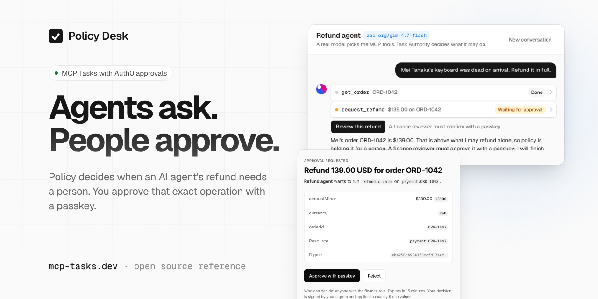

# MCP Tasks · human approvals for agent actions

**Give your agent a refund tool without giving it permission to approve its own refunds.**

This TypeScript reference implementation lets routine requests through under policy and holds sensitive ones for an authorized person. Auth0 verifies the reviewer; the approval covers the exact operation. The agent's [MCP Task](https://modelcontextprotocol.io) waits, then your backend rechecks permission before executing.

[**Try the live demo →**](https://mcp-tasks.dev) · [Run the playground](#try-it-without-accounts) · [How it works](docs/architecture.md) · [Docs](docs/README.md)

[](https://github.com/bharath31/mcp-tasks/actions/workflows/ci.yml)
[](LICENSE)
[](#status-and-limits)

[](https://mcp-tasks.dev)

_Scripted UI preview. [Watch the short walkthrough](https://mcp-tasks.dev/og/policy-desk.mp4), or [try the hosted sandbox](https://mcp-tasks.dev) with real Auth0 sign-in and simulated payments._

> [!NOTE]
> **Independent, experimental, MIT-licensed.** Not an official Auth0, Okta, Anthropic or MCP project. The SDK is a local workspace package, **not on npm**. Use this to evaluate and adapt the pattern, not as a production-ready approval service.

## The problem this solves

Your support agent wants to refund $1,500. A confirmation dialog can ask “allow this tool call?”, but your backend still needs to establish:

- **Who may approve?** Check the reviewer's identity and current permissions, with separation of duties unless policy explicitly permits owner approval.
- **What did they approve?** Bind the decision to the payment, amount and arguments. A changed request cannot reuse the approval.
- **Is it still allowed?** Recheck authorization when the worker claims the operation, even if access changed while it waited.
- **Can another entry point skip review?** Apply the same policy when MCP, REST and CLI call the protected action.

The custom approval backend in this repo, internally called **Task Authority**, implements those checks. It runs inside your Cloudflare Worker in the default deployment—not in Auth0. Auth0 handles login and authentication evidence; Auth0 FGA answers current permission checks. Your app owns the task, business validation and provider call. A database transaction controls the execution claim; **provider idempotency and reconciliation are still required** to prevent duplicate external effects.

**For:** developers building agent tools that move money, deploy code or export sensitive data, and need an inspectable approval implementation. Refunds are the end-to-end example; deploys and exports also have policy templates.

**You may not need this:** if a local tool confirmation or an existing workflow's pause/resume already meets your requirements. [When to use this, and how it relates to LangGraph interrupts and Auth0 CIBA →](docs/why-this-exists.md)

## Try it without accounts

Start with **Node 22+**. No Docker, Claude Code or cloud credentials needed for the playground.

```sh
git clone https://github.com/bharath31/mcp-tasks.git
cd mcp-tasks
npm ci
npm run playground
```

It evaluates the bundled refund policy using the **same validator and evaluator as the service**:

| Request from the sample agent | Decision            | Why                                                            |
| ----------------------------- | ------------------- | -------------------------------------------------------------- |
| $50 refund                    | `allow`             | Small-refund rule, subject to a budget                         |
| $150 refund                   | `approval_required` | Default: one reviewer with fresh MFA                           |
| $1,500 refund                 | `approval_required` | High-value rule: two reviewers, per-operation passkey approval |
| Unlisted action               | `deny`              | Fail closed                                                    |

This is offline policy evaluation, **not** an approval or security simulation. It does not authenticate anyone, check FGA, consume a live budget or move money. The hosted sandbox has its own policy settings.

Change the amount, then edit the rules:

```sh
npm run playground -- --amount-minor 10001   # $100.01: just over the automatic limit
npm run --silent task-authority -- policy init refunds > refunds.json
npm run playground -- --policy refunds.json
```

In `refunds.json`, change the `small` rule's threshold from `10000` to `20000` and rerun: the $150 request now returns `allow`. Keep `--silent` when redirecting output so npm's logs don't enter your JSON. [Policy authoring guide →](docs/approval-policy.md#write-your-first-policy)

### Pick your next step

| I want to…                       | Start here                                                                  | What I need                                                        |
| -------------------------------- | --------------------------------------------------------------------------- | ------------------------------------------------------------------ |
| Click through the UI locally     | `npm run preview:policy-desk`, then [localhost:8787](http://localhost:8787) | Node only; fixture data, no real authentication or approvals       |
| Try a real approval in a browser | [Hosted sandbox](https://mcp-tasks.dev)                                     | Email sign-in and a passkey-capable device; simulated payments     |
| Run MCP Tasks from Claude Code   | [Local walkthrough](docs/claude-code.md)                                    | Node, Docker, Claude Code access; local identity/approver fixtures |
| Deploy with my own Auth0 tenant  | [Cloudflare setup](docs/deploy-cloudflare.md)                               | Cloudflare, Auth0, FGA and Postgres accounts                       |

## Gate an action in your code

After configuring the service and publishing a policy, declare the action once. Call it from your REST route, MCP tool or CLI:

```ts
import { createTaskAuthority } from "@task-authority/sdk";

const authority = createTaskAuthority(); // task-authority.json + TASK_AUTHORITY_* env

type Refund = { paymentId: string; amountMinor: number; currency: string };
const refund = authority.action("refund:create", {
  resource: (r: Refund) => `payment:${r.paymentId}`,
  run: (r, { key }) =>
    stripe.refunds.create(
      { payment_intent: r.paymentId, amount: r.amountMinor },
      { idempotencyKey: key },
    ),
});

const outcome = await refund(
  { paymentId, amountMinor: 150000, currency: "usd" },
  { user: token, key: requestId }, // verified caller token; stable key across retries
);
return outcome.toResponse(); // 201 done · 202 waiting · 401 step-up · 403 denied
```

This is an integration sketch: `stripe`, `paymentId`, `token` and `requestId` come from your backend. Agent callers pass a `delegation` instead of `user`. Keep service credentials on the backend, never in an agent or browser.

`run` executes only after an authorized claim. Your worker resumes an approved request with `refund.resume(operationId, originalInput)`. `outcome.toMcp()` and `outcome.toCli()` render the same decision; your app owns task persistence and polling. [SDK configuration and complete contract →](auth0/sdk/README.md)

## Deploy your own

[](https://deploy.workers.cloudflare.com/?url=https://github.com/bharath31/mcp-tasks)

One Worker hosts the approval service, refund MCP server, Workers AI agent and console. After cloning and running `npm ci`, run `npm run setup` for guided configuration, or `npm run setup -- --deploy` to deploy from the terminal too. Setup uses your own accounts; the deploy button alone does not configure Auth0 or the database.

[Prerequisites and setup guide](docs/deploy-cloudflare.md) · `npm run doctor -- --deploy` checks prerequisites · `npm run verify` checks the deployed configuration.

## Find your way around

| Area                                             | Start here                                                             |
| ------------------------------------------------ | ---------------------------------------------------------------------- |
| One request, from agent to approval to execution | [Architecture diagrams](docs/architecture.md)                          |
| Customer-side workflow                           | [`demo/refund-desk/src/workflow.ts`](demo/refund-desk/src/workflow.ts) |
| Typed client and protected actions               | [`auth0/sdk/`](auth0/sdk/README.md)                                    |
| Policies, approval records and atomic claims     | [`auth0/service/`](auth0/service/README.md)                            |
| Full-stack hosted demo                           | [`demo/policy-desk/`](demo/policy-desk/README.md)                      |
| Durable workflow approval without this service   | [`approve()` experiment](docs/approve.md)                              |

[All guides and checks →](docs/README.md)

## Status and limits

The repo's tests exercise the official MCP Tasks requester and a local identity provider. Claude Code has been tested against the local stack; the hosted demo uses a real Auth0 tenant. [Exact versions, tested paths and trust boundaries →](docs/interoperability.md)

- **No production-hardening claim:** no external security review, load test, retention job or SLA. A compromised worker holding provider credentials can bypass the service.
- **Host support varies:** a client must declare the Tasks extension. Don't assume Claude Desktop, Cursor or another host supports this server's protocol. [Claude Code modes and limitations](docs/claude-code.md).
- **Live setup gaps:** setup has not been verified end to end on a brand-new Auth0 tenant. CIBA, RAR and token exchange have only been tested against local fixtures.
- **Workflow adapters are experiments:** `approve()` has not run on live Auth0. Only its Cloudflare adapter has run on a local engine; the Inngest, Temporal and Vercel adapters remain unverified on real engines.

[Security model](docs/security-model.md) · [Report a vulnerability privately](SECURITY.md)

## Contribute

You don't need an Auth0 account to start:

```sh
npm run test:unit       # SDK and offline policy tests, no database
npm run test:tools      # setup tooling and playground tests, no cloud accounts
npm run db:up          # Docker Postgres for integration tests
npm run check          # build + lint + tests, as in CI
```

`npm run doctor` diagnoses local prerequisites. `npm run db:down` stops the helper container and retains its data. Browser suites run separately in CI.

Useful first contributions: report where setup got stuck, reproduce a host-compatibility issue, or add a policy example for an action you actually need. [Share your use case](https://github.com/bharath31/mcp-tasks/issues/new?template=use_case.yml) or read [CONTRIBUTING.md](CONTRIBUTING.md).

## License

[MIT](LICENSE). “Task Authority” names the experimental approval backend implemented here, not an Auth0 product or API. Auth0 and Okta are trademarks of Okta, Inc.; this project uses those names only to identify the services it integrates with.
