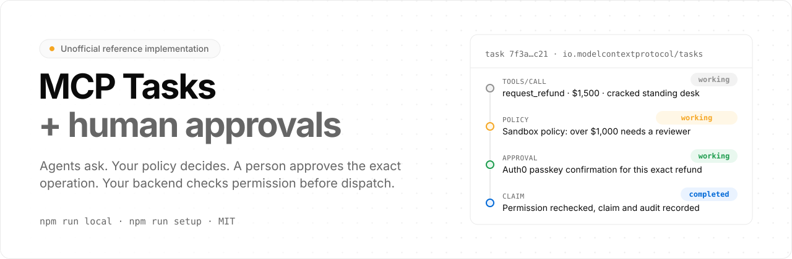

<picture>
  <source media="(prefers-color-scheme: dark)" srcset="docs/assets/banner-dark.svg">
  
</picture>

<p align="center">
  <a href="https://github.com/bharath31/mcp-tasks/actions/workflows/ci.yml"></a>
  <a href="LICENSE"></a>
  <a href="https://mcp-tasks.dev"></a>
</p>

# MCP Tasks + human approvals

A reference implementation of long-running **[MCP Tasks](https://modelcontextprotocol.io)** where an agent's side effects wait for a person. When an agent asks for something your policy holds back, its MCP task waits. A reviewer approves that exact operation with Auth0 (a passkey for high-value actions), and the task resumes and runs once.

- **Approvals live at your API, not in MCP.** An MCP tool, a REST route and a CLI that call the same action get the same decision, so switching clients can't get around it.
- **Policy is a JSON document** with [CEL](https://cel.dev) rules, versions, shadow mode and replay against past traffic. No policy means deny.
- **Exactly one claim.** Authorize and claim happen in one transaction, so racing or crashed workers can't refund twice.

> [!IMPORTANT]
> **Unofficial.** This is an independent, experimental project. It is not made, endorsed or supported by Auth0, Okta, Anthropic or the Model Context Protocol project. "Task Authority", the approval service here, is a proposed design: it is not an Auth0 product and its API is not an Auth0 API. Nothing is published to npm. Auth0 and Okta are trademarks of Okta, Inc.; they are used here only to name the services this code talks to.

## Quickstart

### 1. Run it locally (5 minutes, no accounts)

A local identity provider stands in for Auth0 and plays the approver. You need Node 22, Docker and [Claude Code](https://code.claude.com) 2.1.304 or later.

```sh
git clone https://github.com/bharath31/mcp-tasks && cd mcp-tasks
npm ci
npm run db:up               # Postgres in Docker on 127.0.0.1:55432
npm run local -- --owner    # Task Authority + a refund app with an MCP server; keep it running
```

In a second terminal:

```sh
claude --mcp-config .local/claude-code.mcp.json --strict-mcp-config
```

Ask: `Create a test payment of 30000 USD minor units, then request a refund of 15000 of it for order CC-1, reason "Customer returned the item".` The refund runs as an MCP task (`/tasks` shows it). Claude asks for an exception note, then for the approval page: choose **I'm done, continue**, and the stack approves as the owner with a passkey. The refund runs once, and Claude reports it with the approval's ID.

Stuck? `npm run doctor` checks every prerequisite and prints the fix. More: [docs/claude-code.md](docs/claude-code.md).

### 2. Deploy your own (15 minutes, free tiers)

One Cloudflare Worker runs the whole stack: Task Authority, a refund app with a real MCP server, an LLM refund agent on Workers AI, and the hosted approval page. Auth0 sign-in, MFA, FGA and the policy are real; only payments are simulated.

**a. Deploy the Worker.**

[](https://deploy.workers.cloudflare.com/?url=https://github.com/bharath31/mcp-tasks)

**b. Set up everything else with one command.** You need a new [Auth0 tenant](https://auth0.com/signup), an [Auth0 FGA](https://dashboard.fga.dev) store with a client, and a Postgres database ([Supabase](https://supabase.com) or [Neon](https://neon.tech) free tiers work). Install the [Auth0 CLI](https://github.com/auth0/auth0-cli#installation), then:

```sh
npm run setup
```

Setup asks for what it needs (it remembers your answers, never your secrets), opens the Auth0 and Wrangler logins if you aren't signed in, and configures the tenant end to end: the API, apps, organization, passwordless email sign-in, passkey and authenticator-app MFA, the post-login Actions and the Universal Login text. It then writes the FGA model, migrates Postgres with a least-privilege runtime role, stores every value as a Worker secret, and finishes by checking its own work:

```text
[8] Checking everything (read only)
  ✓ Task Authority API
  ✓ "Policy Desk" app with this origin's callbacks
  ✓ Passwordless "email" sign-in for the app and organization
  ✓ MFA factors: passkeys, security keys, authenticator app
  ✓ Post-login Actions deployed with this repo's code
  ✓ Universal Login text for sign-in and approvals
  ...
✓ Auth0 is fully set up on you.us.auth0.com (10 of 10 checks passed).
  ✓ Worker answers /healthz
```

Re-running is safe: every step looks up what exists first. `npm run verify` repeats only the checks. Prefer the terminal to the button? `npm run setup -- --deploy` deploys too. Step by step, flags and troubleshooting: [docs/deploy-cloudflare.md](docs/deploy-cloudflare.md). Coding agents: [AGENTS.md](AGENTS.md).

## Gate an action in your code

```ts
import { createTaskAuthority } from "@task-authority/sdk";

const authority = createTaskAuthority(); // task-authority.json + TASK_AUTHORITY_* env

type Refund = { paymentId: string; amountMinor: number };
export const refund = authority.action("refund:create", {
  resource: (r: Refund) => `payment:${r.paymentId}`,
  run: (r, { key }) =>
    stripe.refunds.create(
      { payment_intent: r.paymentId, amount: r.amountMinor },
      { idempotencyKey: key },
    ),
});

// In any REST route, MCP tool or CLI command:
const outcome = await refund({ paymentId, amountMinor: 1500 }, { user: token });
return outcome.toResponse(); // 201 done · 202 waiting for approval · 401 step-up · 403 denied
```

`run` executes only after the service has applied your policy, collected any approval and claimed this exact operation. `outcome.toMcp()` and `outcome.toCli()` render the same decision for other transports. The SDK is a workspace package in this repo, not on npm: [auth0/sdk/README.md](auth0/sdk/README.md).

## Start here

| I want to                                  | Guide                                                                                  | Code                                                             |
| ------------------------------------------ | -------------------------------------------------------------------------------------- | ---------------------------------------------------------------- |
| See how the pieces fit                     | [Architecture](docs/architecture.md)                                                   | [Where to look](docs/architecture.md#where-to-look-in-the-code)  |
| Gate an action with the SDK                | [SDK](auth0/sdk/README.md)                                                             | [`auth0/sdk/src/app.ts`](auth0/sdk/src/app.ts)                   |
| Write and test an approval policy          | [Approval policy](docs/approval-policy.md#write-your-first-policy)                     | [`auth0/service/src/policies.ts`](auth0/service/src/policies.ts) |
| Use MCP Tasks from Claude Code             | [Claude Code](docs/claude-code.md)                                                     | [`demo/refund-desk/src/mcp.ts`](demo/refund-desk/src/mcp.ts)     |
| Deploy the full stack to Cloudflare        | [Deploy](docs/deploy-cloudflare.md)                                                    | [`demo/policy-desk/`](demo/policy-desk/ARCHITECTURE.md)          |
| Run the approval service on my own servers | [Service](auth0/service/README.md)                                                     | [`auth0/service/src/`](auth0/service/src/)                       |
| Gate a durable workflow step (no service)  | [`approve()`](docs/approve.md)                                                         | [`demo/refund-workflow/`](demo/refund-workflow/README.md)        |
| Know what is guaranteed and what is not    | [Security model](docs/security-model.md), [interoperability](docs/interoperability.md) | [`auth0/tests/e2e/`](auth0/tests/e2e/)                           |

Every doc, the repository layout and the live checks: [docs/README.md](docs/README.md).

## Status: what is proven and what is not

It passes its own suites, the official `@modelcontextprotocol/ext-tasks` requester and Claude Code against a local stack, and the hosted demo runs on a real Auth0 tenant. Details: [docs/interoperability.md](docs/interoperability.md). **Not proven yet**, so don't rely on it:

- `npm run setup` has never been run end to end against a brand-new Auth0 tenant. The hosted demo's tenant was built up by hand and by these tools over time. If it breaks for you, `npm run verify` says where; please [open an issue](https://github.com/bharath31/mcp-tasks/issues).
- `approve()` has never run on a live Auth0 tenant, and its Inngest, Temporal and Vercel Workflow adapters have never run on a real engine. Only the Cloudflare Workflow adapter has run, locally under Miniflare.
- The only MCP host tested with Tasks is Claude Code, in an interactive terminal session or an Agent SDK run. Claude Desktop, the VS Code extension, one-shot `claude -p`, Claude Code on the web and every other host either don't declare Tasks or are untested.
- CIBA, RAR and token exchange have only run against a local stand-in for Auth0, never a live tenant.

Honest limits by design: one logical authorization is not exactly-once external execution, so provider idempotency and reconciliation still matter. A compromised worker that holds provider credentials can bypass the service. There is no retention job, load test, external review or SLA. Details: [docs/security-model.md](docs/security-model.md).

## Development

```sh
npm run check               # build, lint and every test suite: what CI's main job runs
```

The integration suites need the local Postgres (`npm run db:up`, or set `TEST_PG_ADMIN_URL`). The browser suites (`npm run test:fullstack`, `npm run test:admin`) need Chromium and run in a second CI job. Checks against live services are opt-in and listed in [docs/README.md](docs/README.md#checks).

Issues and pull requests are welcome: [CONTRIBUTING.md](CONTRIBUTING.md). Report vulnerabilities privately, not in an issue: [SECURITY.md](SECURITY.md).

## License

[MIT](LICENSE). Not affiliated with Auth0, Okta, Anthropic or the Model Context Protocol project.
