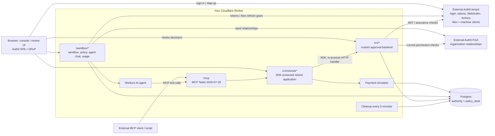

# Policy Desk architecture

Policy Desk co-locates the refund application, MCP server, Workers AI agent, console and **this repository's custom approval backend** in one Cloudflare Worker. That backend is called Task Authority; it is not an Auth0 product or a service running in Auth0. `auth0/service/src/http.ts` is imported into the Worker.

## Components

The root `wrangler.jsonc` is the deploy-your-own configuration. The configuration in this directory is the maintainer's deployment. Both currently connect using `DATABASE_URL`; Hyperdrive is supported but is not configured in either file. One runtime role serves both schemas, so the embedded components are not separate credential boundaries.

## One refund that needs approval

1. The visitor signs in and creates a sandbox. The host seeds FGA relationships, publishes a policy and creates an agent delegation owned by Alex, a different real user.
2. The built-in or external agent calls `request_refund`. `/mcp` and REST use the same protected refund function. The approval backend checks eligibility, pins the arguments and policy, and records an approval request.
3. The MCP Task stays `working` with a review link. It does not ask the MCP client to approve via `tasks/update`.
4. The visitor reads and leases the operation, then requests a digest-bound challenge. Auth0 runs the post-login Actions and the required fresh factor; the browser submits the decision with the resulting token and DPoP proof.
5. The backend checks identity, assurance, binding, replay and current reviewer eligibility. Approval is a database record, not a client boolean.
6. A subsequent `tasks/get` or `POST /v1/refunds/{id}/run` resumes the refund. The executor obtains an atomic claim after authorization rechecks, writes the idempotent simulated refund and reports the outcome.

There is no independent refund worker loop in Policy Desk. The console and agent drive resumption; approval alone does not schedule a refund after every polling client has disconnected. Refund Desk's separate Node worker demonstrates that alternative.

The sandbox uses one high-value reviewer by default (`HIGH_VALUE_QUORUM=1`), unlike the generic refund template's two. Routine sandbox approvals are also per-operation: WebAuthn by default, with an explicit TOTP opt-in for routine refunds only. See [step-up flows](../../docs/approval-step-up-flows.md).

## FGA's role

Auth0 tokens establish identity and authentication evidence. FGA answers whether a user, agent or backend has the required relationship now. The custom backend checks it during delegation, registration, approval and claim; it requests higher consistency and keeps no decision cache. A removed relation is observed on a subsequent check, not retroactively after a claim or payment.

The model is `auth0/service/fga/model.fga`; call sites include `delegations.ts`, `operations.ts`, `approvals.ts`, `claims.ts` and `context.ts` in `auth0/service/src/`.

Hosted FGA is required by this deployment. The Postgres tuple substitute (`ALLOW_LOCAL_FGA=1`) is for local tests, not a supported production alternative. FGA is not inherently required by the approval pattern; replacing it would require an implementation and verification of the permission interface.

## Lifetime and experimental mode

Sandboxes expire after 15 minutes, with cleanup scheduled every five minutes. MCP advertises a 24-hour task TTL, but sandbox expiry/cleanup limits actual access sooner. Reset creates a new generation; it does not preserve prior operations.

`APPROVAL_MODE=approve` is a separate, local-fixture-tested experiment using Auth0-signed proofs instead of Task Authority refund-policy decisions. It still runs inside the Policy Desk host and uses its Postgres state. It must not be confused with the default authority mode or with the standalone database-free workflow example. See [README](README.md) and [approve()](../../docs/approve.md).

For the alternative deployment, claim limits and code map, see the [repository architecture](../../docs/architecture.md).
