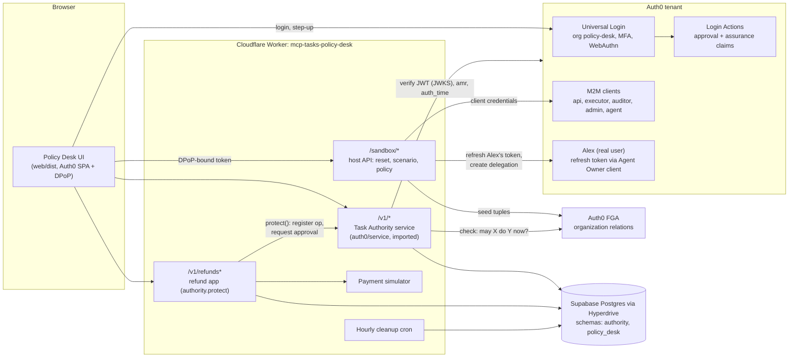
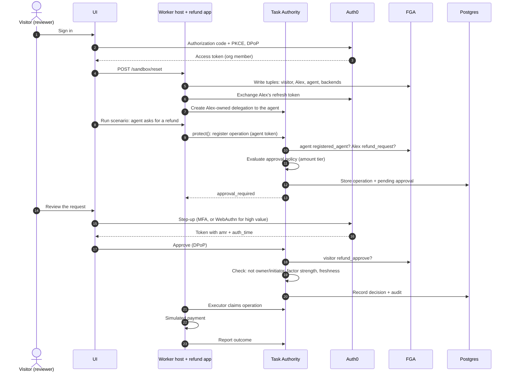

# Policy Desk architecture

## Components

## One refund that needs approval

## Why FGA

Tokens prove who the caller is and how they signed in. They don't prove the caller may still do this action right
now: a delegation or an approval can wait for hours, and a person's role can change in the meantime. The service
asks FGA at every decision point (create delegation, register operation, approve, claim). It never caches the answer
and fails closed when FGA is unreachable. Revoking a relation in FGA therefore stops in-flight work immediately.

The relations live in `auth0/service/fga/model.fga`. The call sites are `fgaCheck` in
`auth0/service/src/{delegations,operations,claims,context}.ts`.
