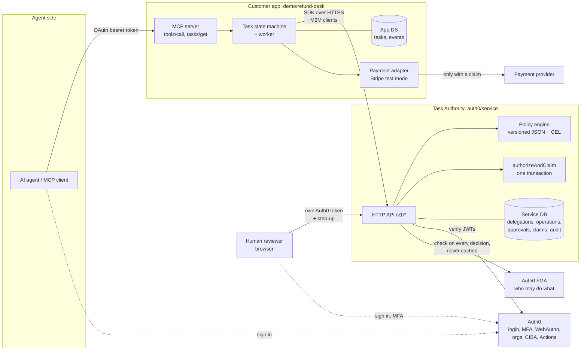
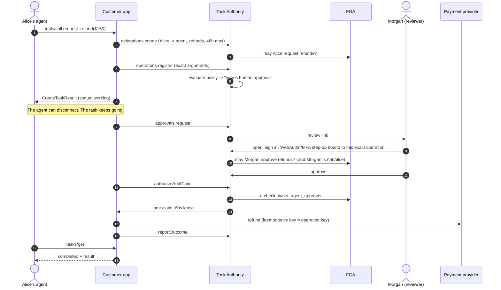

# Architecture

**In one sentence:** an AI agent asks for something risky over MCP (say, a $150 refund), the request becomes a long-running MCP Task, and a separate authorization service, built on Auth0 and FGA, decides whether it may happen, who must approve it, and hands out exactly one permission to do it.

The repo has three layers:

| Layer                      | Path                                      | Owns                                                                        | Analogy                      |
| -------------------------- | ----------------------------------------- | --------------------------------------------------------------------------- | ---------------------------- |
| **Customer app**           | `demo/refund-desk/` (also `deploy-gate/`) | The MCP server, the task, the business rules, the provider call (Stripe)    | The shop                     |
| **SDK**                    | `auth0/sdk/`                              | Typed client for the service, plus `authority.protect` and MCP Task helpers | The card reader              |
| **Task Authority service** | `auth0/service/`                          | Delegations, policy, approvals, the atomic claim, audit                     | The bank that says yes or no |

Auth0 proves **who** someone is and **how strongly** they signed in (MFA, WebAuthn, DPoP). FGA answers **may they do this right now**. The service combines both at every decision. It never touches payment credentials, and the app never touches the service's tables.

## The picture

## One request, start to finish

## The ideas that make it safe

1. **Identity only comes from verified tokens.** No request body can say "I am Alice" or "approved: true". The tenant comes from the token issuer.
2. **An approval covers exactly one operation.** The service hashes tenant, org, delegation, action, resource, canonical arguments and business-state version into a digest. Change the amount by a cent and the approval no longer applies.
3. **Permission is re-checked at the last moment.** FGA is asked at registration, at decision **and** at claim, with no caching. If someone loses access while a task waits for hours, the next check denies. If FGA is unreachable, the answer is `authorization_unavailable` and nothing is claimed.
4. **Exactly one claim.** Authorize-and-claim is one database transaction with a unique index on live claims. Racing or crashed workers recover the same claim or get `reconcile_required`. They never get a second refund.
5. **Strong, fresh human approval.** Reviewers need fresh MFA. High-value policies also need a step-up bound to the operation digest (WebAuthn-first via a service challenge, or RAR through PAR). CIBA push is only an explicit escalation path.
6. **Policy is data.** Versioned JSON policies per resource server, with shadow activation and simulation. Rules can allow, require step-up, require approval, deny, or spend from a budget. No policy means deny.
7. **Hard boundaries.** Separate databases and credentials for app and service. `auth0/tools/check-boundaries.mjs` fails `npm run lint` on imports or SQL that cross the line.

## Where to look in the code

| Question                                 | File                                                      |
| ---------------------------------------- | --------------------------------------------------------- |
| What does the customer side actually do? | `demo/refund-desk/src/workflow.ts` (about 100 lines)      |
| How does an MCP tool call become a task? | `demo/refund-desk/src/mcp.ts`, `tasks.ts`                 |
| What does the SDK give me?               | `auth0/sdk/README.md`, `auth0/sdk/src/protect.ts`         |
| How is a decision made?                  | `auth0/service/src/policies.ts`, `operations.ts`          |
| How do approvals and step-up work?       | `auth0/service/src/approvals.ts`, `ciba.ts`               |
| The atomic claim                         | `auth0/service/src/claims.ts`                             |
| The FGA model                            | `auth0/service/fga/model.fga`, `auth0/service/src/fga.ts` |
| Auth0 tenant hooks                       | `auth0/actions/*.cjs`                                     |
| What is and isn't guaranteed             | [security-model.md](security-model.md)                    |
| Policy admin and CLI                     | [approval-policy.md](approval-policy.md)                  |

---

## Sequence: manager exception ($150)

1. Alice's agent calls `request_refund` (client declared the tasks extension). The app validates the business facts, exchanges the token (OBO), and calls the SDK: `delegations.create` then `operations.register` (exact arguments, customer policy assertion = human, business-state version). Only then is the task persisted and `CreateTaskResult` returned. Status is `working`.
2. The client may disconnect. A signed warehouse event arrives; the receipt and the task transition commit in one transaction.
3. The worker asks the service for a human decision (`approvals.request`). The status message carries the review link. Nothing is waiting on the client.
4. Morgan opens the link, signs in, reads the exact operation from the service, re-authenticates with fresh MFA bound to `{approval_id, operation_digest}`, and posts the decision _to the service_. The service verifies identity, assurance, binding, replay, FGA eligibility, and separation of duties.
5. The worker (executor role) calls `authorizeAndClaim`. In one transaction the service re-checks delegation, digest, state version, approval, and FGA for the owner/agent/approver, and mints one claim with a 60 s lease.
6. The adapter refuses to act without that claim. The provider is called with the operation key as idempotency key; the outcome is reported back (unverified attestation).
7. The task completes. Any client with a valid credential for Alice reads the retained result for 7 days via `tasks/get`.

## Lifetimes (demo fixtures, not product defaults)

| Thing                    | Default                                | Independent of               |
| ------------------------ | -------------------------------------- | ---------------------------- |
| Access token             | issuer-defined                         | delegation, task retention   |
| Delegation               | 48 h max                               | credentials                  |
| Approval window          | 30 min, capped by delegation/operation | claim lease                  |
| Claim lease              | 60 s                                   | approval                     |
| Task result retention    | 7 days                                 | authority expiry             |
| Audit / idempotency rows | not deleted by this code               | must outlast possible replay |

## Data ownership

| Record                                                          | Owner    | Where                                       |
| --------------------------------------------------------------- | -------- | ------------------------------------------- |
| Task, status, result, events, warehouse receipts                | Customer | `refund_desk.*`                             |
| Delegation, operation, approval, claim, outcome evidence, audit | Service  | `authority.*`                               |
| Provider refund, idempotency, metadata                          | Provider | Stripe or the labelled simulator            |
| Relationships (who may do what)                                 | FGA      | store + model `auth0/service/fga/model.fga` |

The service never receives provider credentials; the customer never reads or writes `authority.*` (a database role without grants gets `42501`; `auth0/tools/check-boundaries.mjs` blocks imports and SQL that cross the line).

## Compatibility notes

- Per-request protocol metadata (no `initialize`); legacy `initialize` is refused with a message naming the supported version.
- `tasks/list`, `tasks/result` and `subscriptions/listen` are not implemented or advertised; polling is the contract.
- Status mapping lives in `demo/refund-desk/src/tasks.ts`.
