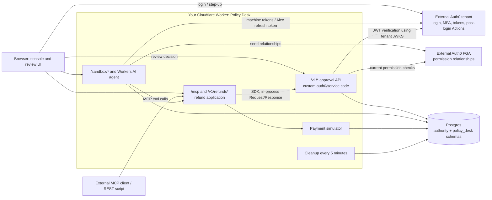
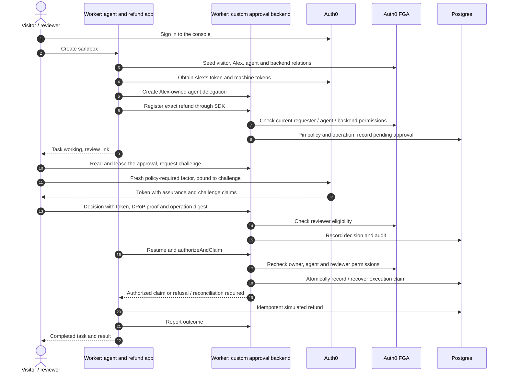
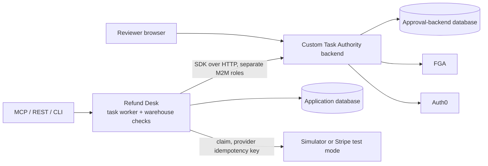

# Architecture

An agent requests a refund. The application records the exact operation; **the approval backend implemented in this repo** evaluates policy, verifies any required human decision, and rechecks authorization before granting an execution claim. MCP Tasks exposes the application's progress to the agent. Provider idempotency and reconciliation, not the claim alone, prevent duplicate external effects.

The backend's internal name is **Task Authority**. It is code you deploy, not an Auth0 product, Auth0-hosted service, or Auth0 Action. The `auth0/` directory groups this project's approval components and Auth0 integration code; it does not indicate Auth0 ownership.

## What runs where

| Component           | Implementation                                    | Responsibility                                                                                                                                |
| ------------------- | ------------------------------------------------- | --------------------------------------------------------------------------------------------------------------------------------------------- |
| Approval backend    | `auth0/service/`                                  | Delegations, versioned policies, budgets, approval records, execution claims, revocation and audit                                            |
| Application SDK     | `auth0/sdk/` (`@task-authority/sdk`, unpublished) | Calls the backend and invokes application callbacks after a claim; does not schedule work                                                     |
| Policy Desk         | `demo/policy-desk/`                               | Console, refund REST/MCP API, Workers AI agent and payment simulator; embeds the approval backend                                             |
| Refund Desk         | `demo/refund-desk/`                               | Alternative Node app with a durable task worker, warehouse prerequisite and simulator/Stripe test adapter; calls a separately running backend |
| Auth0               | External tenant                                   | Login, OAuth tokens, Organizations and authentication factors; runs the repository's post-login Actions                                       |
| Auth0 FGA / OpenFGA | External permission store                         | Current requester, reviewer, agent and backend relationships                                                                                  |
| Postgres            | Database you supply                               | Application and approval-backend records                                                                                                      |

Auth0 Actions require or attest authentication during login. They do **not** own refund policy, the queue, task storage or execution claims. DPoP binds a token to a client key; it is not itself an authentication factor.

## Default deployment: one Cloudflare Worker

The root `wrangler.jsonc` deploys Policy Desk. There is no second approval service to acquire or deploy.

Both checked-in Worker configurations use `DATABASE_URL`; neither currently declares a Hyperdrive binding. `src/db.ts` also supports a `HYPERDRIVE` binding if you configure one. The Worker shares a runtime database role across the two schemas: these are **logical component boundaries, not process or credential isolation**.

Each visitor gets a sandbox derived from their verified subject and a backend tenant per sandbox generation. Sandboxes expire after 15 minutes; cleanup runs every five minutes. The Node backend instead selects configured tenants by issuer. Do not confuse either backend tenant with an Auth0 Organization.

## One Policy Desk approval

This is the default `APPROVAL_MODE=authority` path. High-value quorum defaults to **one** in Policy Desk so one visitor can finish the demonstration; the generic refund template requires **two**. Routine sandbox approvals also use per-operation WebAuthn by default; an explicit sandbox setting permits TOTP for routine approvals only. See [step-up flows](approval-step-up-flows.md).

**Progress requires a driver.** Policy Desk resumes eligible refunds on `tasks/get` or `POST /v1/refunds/{id}/run`; the console and built-in agent drive those calls. It is not an independent, always-running refund worker. Closing every polling client does not itself schedule execution.

## Alternative: separate Node app and backend

Refund Desk owns durable tasks and a worker loop. Once its warehouse and approval prerequisites are met, work can continue without the MCP client. `auth0/tools/check-boundaries.mjs` prevents Refund Desk and Deploy Gate from importing approval-backend internals or accessing its authorization tables. Policy Desk deliberately embeds that backend and is excluded from these customer-app restrictions.

## Authorization and execution limits

- **Exact operation:** the digest binds tenant, organization, delegation, operation key, action, scope, resource, canonical arguments and business-state version. Facts and policy snapshots are stored separately and checked on registration replay; facts are trusted application assertions.
- **Current permission:** FGA is checked at delegation, registration, approval and claim boundaries. The client requests `HIGHER_CONSISTENCY` and does not cache decisions. Outages fail closed. Revocation takes effect at a subsequent check, not retroactively after an external side effect.
- **Separation of duties:** the default excludes the initiator and delegation owner. `self_approval: "owner"` permits a user-owned agent's owner to approve a single-reviewer operation with a fresh, operation-bound WebAuthn factor. It does not permit agent tokens or human-direct self-approval.
- **Atomic claims, not exactly-once payments:** racing workers recover the same live claim or receive `reconcile_required`. They must use a stable provider idempotency key and reconcile uncertain dispatches. `not_submitted` is an executor attestation that can release a claim.
- **Provider credentials remain with the app:** the backend does not need them, but a compromised executor that holds them can bypass the approval path.

### Is FGA required?

For the current hosted deployment, **yes**: configuration requires an FGA API URL and store. FGA supplies permission checks; it does not store tasks, evaluate the refund policy or prove the human decision. `ALLOW_LOCAL_FGA=1` selects a Postgres tuple implementation for local tests only.

The approval pattern does not inherently require hosted FGA. The service's `Fga.check(user, relation, object)` interface could be implemented differently, but a production replacement and supported deployment path are **not implemented here**. See `auth0/service/fga/model.fga`, `auth0/service/src/fga.ts` and `demo/policy-desk/src/auth0.ts`.

## Lifetimes and data ownership

| Record                 | Standalone demo defaults                   | Policy Desk                                                                                                                             |
| ---------------------- | ------------------------------------------ | --------------------------------------------------------------------------------------------------------------------------------------- |
| Access token           | Issuer-defined                             | Issuer-defined; an external-agent token also needs a live sandbox binding                                                               |
| Delegation             | Maximum 48 hours                           | May be renewed during sandbox setup/scenarios; sandbox expiry still gates execution                                                     |
| Approval window        | 30 minutes, capped by operation/delegation | Backend limits plus the 15-minute sandbox lifetime                                                                                      |
| Claim lease            | 60 seconds                                 | 60 seconds                                                                                                                              |
| Task result            | Refund Desk retains results for 7 days     | MCP advertises 24-hour `ttlMs`, but sandbox expiry/cleanup makes records unavailable sooner; it is not a 24-hour availability guarantee |
| Audit / policy records | No general retention job                   | Demo tenant records are removed by a narrowly scoped owner-defined cleanup function; usage totals are archived                          |

## Code map

| Question                             | Start here                                                                   |
| ------------------------------------ | ---------------------------------------------------------------------------- |
| Hosted request routing / co-location | `demo/policy-desk/src/app.ts`, `host.ts`, `worker.ts`                        |
| Hosted MCP Tasks and resumption      | `demo/policy-desk/src/mcp.ts`, `refunds.ts`                                  |
| Standalone durable workflow          | `demo/refund-desk/src/workflow.ts`, `tasks.ts`                               |
| SDK and renderers                    | [SDK README](../auth0/sdk/README.md), `auth0/sdk/src/protect.ts`             |
| Policies and operations              | `auth0/service/src/policies.ts`, `operations.ts`                             |
| Approvals, assurance and claims      | `auth0/service/src/approvals.ts`, `claims.ts`, `ciba.ts`                     |
| Login hooks                          | `auth0/actions/*.cjs`                                                        |
| Tests and live-verification limits   | [Security model](security-model.md), [interoperability](interoperability.md) |
| Separate workflow-proof experiment   | [approve()](approve.md); not the default hosted approval path                |

Both MCP servers use per-request `2026-07-28` metadata and `server/discover`, not `initialize`. They implement polling, not `tasks/list`, `tasks/result` or subscriptions. Host support is recorded in [interoperability](interoperability.md), not inferred from generic MCP support.
